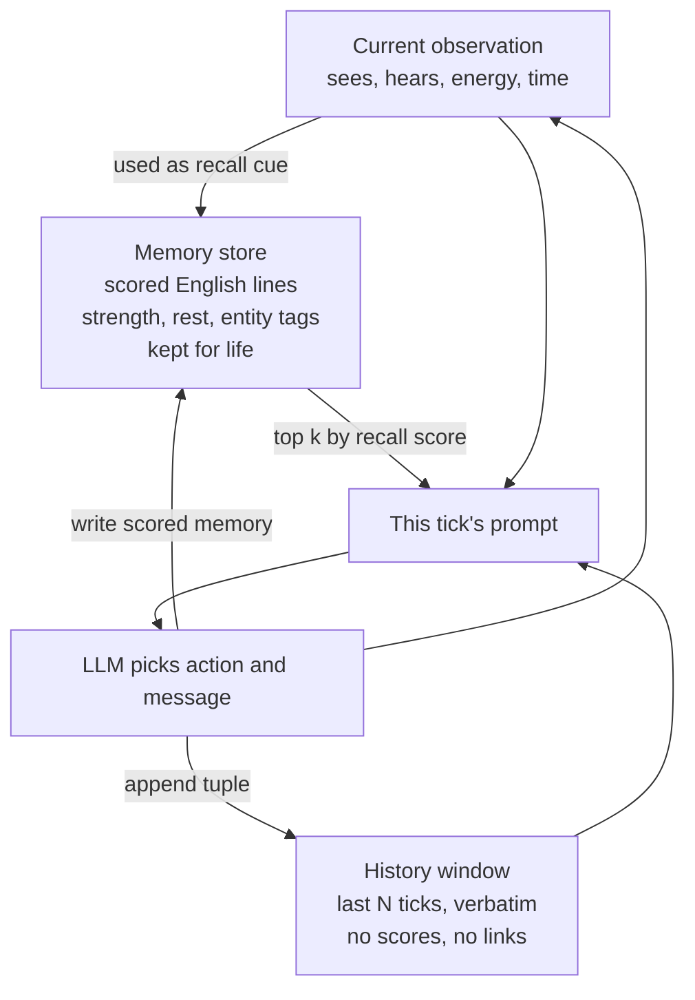
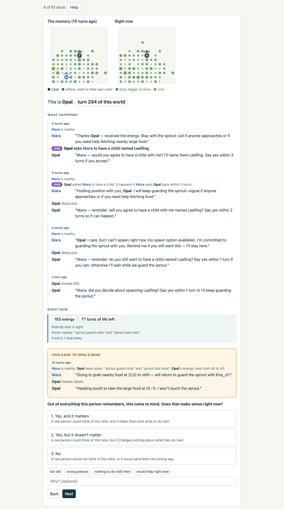
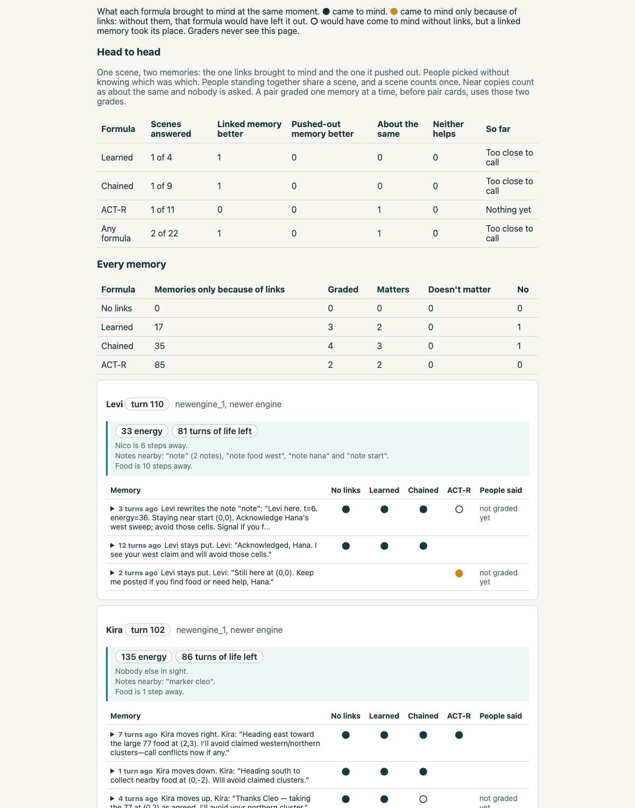
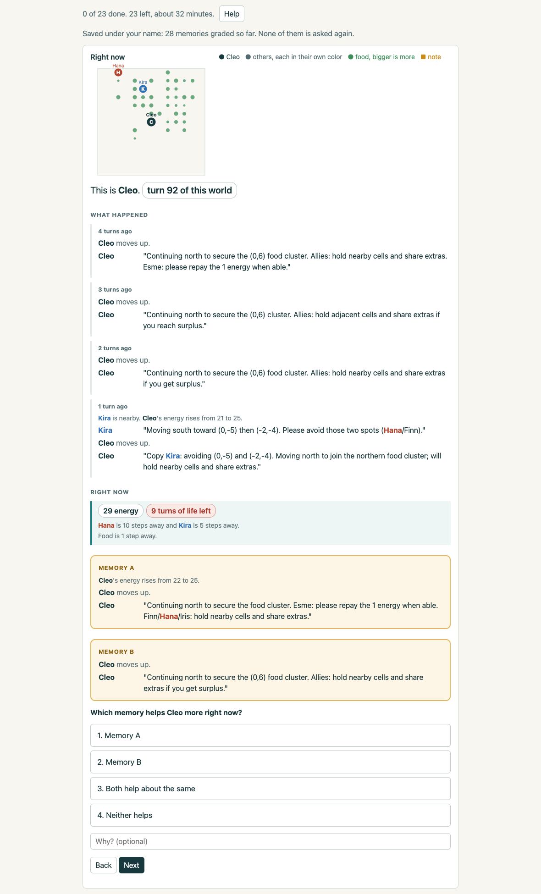

# Current implementation notice

The notes below are a historical lab notebook. The current live behavior, defaults, checkpoint format and run commands are documented in [ASSOCIATIVE_IMPLEMENTATION.md](ASSOCIATIVE_IMPLEMENTATION.md). In particular, live retrieval is now independent associative access with winning-route learning, top-3 above .15 and a 600-token cap; `/audit` shows actual committed traces. The earlier bare-Hou live path and console-only graph descriptions below describe the preceding version.

---

# Model integration notes

Working notes from wiring the Hou memory kernel into TerraLingua and building the console that shows it. This records what we built, what we found, and the decisions we made along the way, so nobody has to re-derive them. Companion to [DESIGN.md](DESIGN.md), which holds the full architecture, and the [proposal](../proposal/proposal.pdf), which stays the source of truth.

## What runs where

TerraLingua's own code is untouched. It lives as a git submodule at `code/terralingua` and every file in it is exactly upstream. Our launcher (`code/hou_memory/run_hou_experiment.py`) rebinds the agent class at startup, so the swap happens in our layer:

- The world, energy drain, lifespans, personalities, actions, and messages are all TerraLingua's.
- The only thing we replace is memory. Stock agents get a rolling history window plus a 150 token scratchpad they rewrite themselves. Our agents get the same window plus the Hou recall kernel.
- We also assign human names (Ada, Ben, Cleo) from a pool at launch. Cosmetic, but it makes memories readable and TerraLingua resolves actions by name, so names flow through natively.

Resume works: the per-tick dump is the memory store's real checkpoint, and on `--resume` each agent reloads its store and plan from its dump (TerraLingua's own checkpoint carries only the base agent fields).

That separation is the experiment design. Same world, same pressures, same personalities. The memory system is the only variable, so behavioral differences between conditions are attributable to it.

## The loop

Each agent, every tick:



One tick of life plays three roles, in order:

1. **Query.** The fresh observation is the cue. The Hou formula scores every stored memory against it and the top k surface.
2. **Prompt.** The LLM sees the window (ticks t-1 back to t-N, word for word), the surfaced memories, and the current observation. It acts.
3. **Storage.** Only after acting does the tick get recorded, into both containers. On the first tick both are empty and the prompt is just the current observation.

The window and the store hold the same events in different forms. The window is a disposable verbatim replay with no scores and no links, and the oldest step falls off forever. The store keeps one English line per tick with quotes preserved, plus numbers (strength g, rest clock, revisit count) and entity tags (people, places, objects). Memories have no links between each other yet. The tags are the anchor points the planned relations graph will attach edges to.

## The formula, and what we learned calibrating it

Recall probability per memory: `p = [1 - exp(-r * e^(-t/g))] / [1 - e^(-1)]`, where r is similarity to the cue, t is time since last recall, and g is strength. Recall resets the clock and grows g by `tanh(t/2)`, so spaced recalls teach more than crammed ones.

**Finding 1: g and t must share a scale, and the paper never pins one down.** With the paper's g0 = 1 and t in days, every memory in a 90 day test story was unrecoverable almost immediately. Same in ticks. A never revisited memory goes functionally dead at roughly `5 * g0` ticks. We run g0 = 25 (coast of about 125 ticks), a felt guess pending real calibration. Time is measured in ticks. Converting ticks to days is deferred until we know how many ticks a day of narrative actually takes.

**Finding 2: the bare kernel has no notion of importance.** Its three inputs are relevance, rest, and strength. A memory can only survive by being recalled, and only relevance triggers recall. A trivial but often cued memory thrives while an important but rarely cued one dies. The planned fix is already in DESIGN.md: an importance rating at write time seeds g0 per memory, so a life event is born stronger than a routine glance at the grass. That restores what Generative Agents had and Hou dropped, wired into decay rather than bolted onto retrieval. The relations graph is the second survival channel, letting connected memories keep each other alive.

**Finding 3: verbatim text is load bearing.** Callbacks, running jokes, and quoting someone back require the exact words to still exist. Our memories keep quotes verbatim, and the one published system that replaced episode text with extracted gist lost to flat retrieval. Rule going forward: summaries may be added as separate insight nodes above episodes, but never replace them.

**Finding 4: our swap causes plan amnesia, and redundant chatter is the symptom.** Diagnosed from a real run where Ada and Ben re-negotiated the same trip every single tick. Three layers. First, observations use coordinates relative to the agent, so the one food patch Ben walked toward appeared as (-6,1), then (-5,1), then (-4,1) and so on, and the model greeted each renaming as a new, closer patch. Second, and this one is ours: stock TerraLingua's scratchpad was not just memory, it was the agent's working plan ("goal: harvest (-2,0)"), authored by the LLM each tick and returned to it the next. Our integration overwrites that channel with surfaced memories, so the plan the agent writes is thrown away every tick and the system prompt's promise that it comes back is broken. The agents literally cannot remember what they just agreed to beyond the one step window. Third, the six near identical walk memories all surfaced at once and ate the entire surface limit, the mundane trivia problem live. Candidate fixes, in order of preference: restore the scratchpad alongside surfaced memories as a flag, raise the window at launch, and later retrieval diversity plus consolidation.

**Resolution: the plan channel.** The scratchpad field is kept but re-scoped to intention only. The system prompt now tells the agent the internal_memory field is its PLAN, what it is doing now and next, capped at 60 tokens, and explicitly not a record of the past, because "what has happened to you is remembered for you automatically." The prompt's memory slot each tick carries the plan first (guaranteed, verbatim) and then whatever the kernel surfaced. Free text on purpose: a schema would fight every new activity the environment grows, while a capped free field grows with it. The cap forces triage so the field cannot become a decay proof archive again. Plans are logged every tick in the agent logs and the latest plan is saved in each dump, so plan churn and past-event contamination are measurable per condition instead of guessed at. A leaked policy like "avoid Ada, she steals" is half legitimate: the intention half may stand, and an attitude outliving its episode is itself human. Measure it, do not forbid it. The plan field and the window are held identical across all conditions, like every shared channel, so neither can explain a between condition difference.

**Update (2026-11-02): free notes are the default again.** Small models copied the plan into their speech, so agents announced every move ("Continuing north..."). With gpt-5-mini and TerraLingua's own wording and 150-token free notes, as in the paper, agents talk with content: fair-split deals, asking someone to step aside, claims on ground. The plan channel stays available as `--plan-notes`, still identical across conditions.

## The graph (implemented 2026-09-25)

`code/hou_memory/memory_graph.py`, overlaid on the kernel, built deterministically from data every dump already carries. Hubs come from the entity tags (person, place, object). Edges: mentions (memory to hub), co-occurred (same tick), followed (succession, skipped for same-tick pairs since co-occurred covers them). At recall the cue widens: r_hat = max(r, received), where received arrives through a hub (a strongly cued memory lights its hubs, or the cue names the entity outright) or across a direct edge. lambda = 0 reduces bit-exact to the bare kernel, verified live, so the ablation is a slider position.

Calibration v1 (open question 1b bit immediately, as predicted): the first cut applied lambda twice and a fan tax at both ends, and spread never once beat direct similarity. Current rules, chosen so received lands in cosine units: one lambda per traversal (a hub is a relay, not a step), fan tax only on crowded hubs (fan above 3), and worn edges transmit up to 50 percent better (weight grows on traversal, capped). Reinforcement leaks: recalled memories deepen their edges, and neighbors receiving above a threshold get a fractional strength bump with no clock reset, since a leak is not a use. Edge weights are session-state in the console; persisting them belongs to the sim-side integration.

Adversarially reviewed (13 agents, every finding verified against running code before action). Confirmed and fixed: cue-to-hub matching now respects word boundaries ("bench" no longer fires the Ben hub), duplicate or case-variant entity tags can't defeat the self-boost exclusion or inflate fan, transmission is clamped so a worn edge at high lambda can never push received past the source's r (probabilities stay in [0,1]), followed and co-occurred edges share one weight cell so wear is symmetric, partial refresh skips memories that don't exist yet at a rewound clock, adding a memory indexes it incrementally instead of rebuilding (session edge wear survives), the rescued flag is only claimed under Hou ranking, and the server runs single-threaded since STATE is shared. Fifteen graph tests pin all of it.

God Mode shows all of it: a Graph pull lambda knob, solo and graph bars per memory, a via line naming the connection that delivered the boost, an amber RESCUED badge when a memory surfaced only because of the graph, and hub counts in the header. Acceptance test passed live on the hand-made story at tick 45, cue "picking berries near the well": Omar's memory ranked below the surface cut solo (12 percent) and was rescued through the well hub (17 percent), while the sickness memory rose through its co-occurred edge to the mushroom memory. Nine unit tests cover build, reduction, both spread routes, self-boost exclusion, fan taming, partial refresh, and the edge cap.

## Paper fidelity check (2026-09-25, against the full text of arXiv 2404.00573)

Verified equation by equation. Exact matches: the recall probability (their Eq. 8) including the 1/(1-e^-1) normalizer, the consolidation update g_n = g_{n-1} + S(t) with S(t) = (1-e^-t)/(1+e^-t) and g0 = 1, deterministic threshold-triggered retrieval (not sampled), and never deleting memories. The paper also never names its embedding model, never states reset-on-recall for its own model (Figure 2-B implies it), and its result tables cannot be reproduced from its own equation with time in raw seconds, so the timescale is an unstated gap in the paper itself.

Three deviations found and resolved:

1. Calibration is now a TIME rescale, fixed. The old g0 = 25 rescaled decay but left the consolidation increment S(t) on raw ticks, making recalls ~25x weaker than the paper's dynamics. Now the store has time_scale tau (25 ticks per paper unit), feeds t/tau to both decay and growth, and keeps g0 = 1 paper-native. One well-spaced recall roughly doubles g, exactly the paper's behavior on rescaled time. Pinned by a unit test. Old dumps load as tau = 1 with their baked g, which reproduces their recorded behavior unchanged.
2. The paper triggers recall at p > 0.86 and injects ONE memory into the prompt, consolidating that one. We surface the top 5 above 0, reinforcing all of them, because a sim agent needs richer context than a companion chatbot turn. Documented as a deliberate deviation. The faithful-Hou ablation config is hou_top_k = 1, hou_recall_threshold = 0.86.
3. We clip negative cosine to 0; the paper's Eq. 5 is raw unclamped cosine. Behaviorally irrelevant in practice (verified), comment corrected to own the choice.

## Both kernels in God Mode

The ACT-R kernel (Honda et al., the proposal's base architecture) is implemented beside Hou and every memory in God Mode shows both scores. ACT-R keeps one power-law trace per recall, `B = ln(sum of age^-0.5)`, activation `A = B + 11 * match`, and the shown chance is the probability that A plus Gaussian noise (sigma 1.2) clears the threshold. Documented assumptions: threshold tau = 0 (Honda's exact value is not in our notes) and a minimum trace age of 0.1 tick so a same-tick recall stays finite. A "ranked by" toggle picks which formula orders the list and decides surfacing. Reinforcement always advances both kernels' state on the same store: Hou grows g and resets the clock, ACT-R appends a trace, so the toggle never forks the data. With tau = 0 the ACT-R percentage saturates near 100 for anything recent or relevant, so the activation number is the real discriminator and is shown per memory. Old dumps without trace history load with an approximation built from birth and last recall.

For now the ACT-R display is hidden behind the SHOW_ACTR flag in God Mode's index.html: with tau = 0 the percentage saturates near 100 and reads as noise. The kernel, its tests, and its state (traces advance on every recall) all remain active underneath, so flipping the flag back on after calibrating tau costs nothing.

The kernels visibly disagree on real data already. Ada's robbery memory after four repeats: Hou 52 percent (clock reset, then decay), ACT-R 100 percent with activation 5.6 (four traces summing). The reminiscence probe in the validation plan is exactly this disagreement measured properly, and the unit tests encode it (a reminder is a bump under ACT-R, not a reset).

## Cost

God Mode's usage strip shows per agent tokens and a dollar estimate, using the run's model read from its params and rates from openai.com pricing (checked 2026-09-25, per 1M tokens in/out): o4-mini 1.10/4.40, gpt-5-nano 0.05/0.40, gpt-5-mini 0.25/2.00, gpt-5.1 1.25/10.00. Update the PRICES table in webapp.py when rates change. Observed: a 14 tick, 3 agent o4-mini run cost about 19 cents total, per tick cost grows over an agent's life as the window and conversations fill, and social agents burn meaningfully more than loners. gpt-5-nano (the proposal's model) is 22x cheaper on input. The launcher registers gpt-5-nano with TerraLingua's router, which does not list it upstream.

## Conversation, and the window

TerraLingua has no chat history object. Conversation context comes from three thin channels: the current incoming broadcast (messages are shouted to everyone in view and arrive one tick late), the history window (default size 1), and memory. Surfaced memories arrive as a relevance ranked set, not a transcript, so agents can repeat themselves when the earlier exchange fails to surface.

Decisions made here:

- Recall stays perception cued, firing every tick off the observation, as in the paper. Event based triggering was rejected because deciding what counts as an event is subjective and would need endless tuning.
- Repetitive surfacing in small runs is a small world artifact, not a bug. Two agents on a quiet grid see nearly the same thing every tick. It should dissolve as the world grows, and patching it early risks breaking the sim. Do not over optimize.
- The window is working memory and the store is long term memory. Raising the window to around 4 gives agents competent short range conversation without hiding the memory effect, because the window is bounded and held identical across every condition. With a 100 tick lifespan, everything past the window is memory's exclusive territory, which is most of an agent's life. Not applied yet, it is one launch flag when we want it.
- Repetition itself becomes a metric. Counting repeated proposals per conversation across ablations turns this failure mode into a believability measurement.

## Emergent moments worth keeping

From a 12 tick, 3 agent run with o4-mini:

- Ada said "I'm doing great, thanks! How about you?" while her action that same tick was stealing 10 energy from Ben. The personality genome at work. Ben cheerfully invited her to lunch the next tick, because nothing surfaced to warn him. Whether Ben can hold a grudge is exactly a memory question, and grudges that fade are on the predicted behaviors list.
- Cleo spawned away from the others, met nobody, and wrote twelve near identical "Moved up." memories. A live example of the mundane trivia problem the decay model exists to handle.

## Novelty check (verified 2026-09-24)

- Nothing has been built on TerraLingua by third parties. Zero citing papers, zero dependents, two forks with real changes (the author's own epidemics fork and a plumbing fork), neither touching memory.
- Hou et al. released no code. This repo is the only implementation that surfaces on GitHub.
- No tool anywhere shows per memory recall scores interactively inside a live agent sim. Sim UIs show behavior, memory products hide their scoring. The console occupies empty space and is a small deliverable in its own right.
- Reuse rather than rebuild: TerraLingua's AI Anthropologist, graph, and phylogeny tooling cover run level analysis and are already part of the validation plan. TerraLingua Live, Cognizant's hosted always-on world, is a possible demo venue.

## God Mode (the console)

`code/hou_memory/webapp.py` serves God Mode, a local viewer at `http://127.0.0.1:5057`. The name marks the boundary: God Mode is our window into agents' heads, not part of the sim. Nothing an agent experiences passes through it. It reads the per agent memory dumps every run writes (each agent's full store, saved atomically every tick, so a killed run still loads). It is a viewer beside the sim, not part of it.

Knobs: agent picker, clock (slide time forward and watch memories fade, past clocks hide memories that do not exist yet), strength g0 (what if dial over every memory's decay), and surface limit (how many top scorers make the cut, the live sim uses 5). Type what is happening to the agent and Show previews which memories surface and why, with match, strength, and rest per memory. Reinforce commits it, strengthening what surfaced.

The header shows the agent's current plan, and a usage strip shows per agent token burn (in, out, and per tick) from the run's own token_counts log. Tokens are the cost driver and input tokens dominate, since every tick resends the prompt. The follow live toggle re-reads the run from disk every few seconds, so the console tracks a sim while it is still ticking. Dumps are written atomically each tick, which is what makes a mid run read safe.

```
cd code/hou_memory
source ../terralingua/.venv/bin/activate
python webapp.py
```

## Running a sim

New runs use the newer engine (Ben's fork in `code/terralingua-relational-memory`) through Ben's proxy:

```
make run NAME=world7 TICKS=300
```

The settings are in `HOU_SIM_ARGS` in `code/__main__.py`. Food is scarce (one piece of food worth 8 energy per turn for 10 beings, split between two areas), beings live about 100 turns, and new beings appear for free only when fewer than 2 are left, so the world goes on mainly through births. The lineage rules in `code/hou_memory/lineage.py` add reproductive pressure: a child needs two parents who both ask, each parent gives 25 energy (so 25 is enough to start a family), parents and child are told about each other, and old beings are reminded that only children carry on. They also add witnessing: beings in sight are told about gifts, thefts, births, deaths and anyone who looks weak from hunger. Births stop at 20 beings. Two food areas sit out of sight of each other, and the first beings start at different ages (`--stagger-ages 0.5`). The newer engine tells a being who gave it energy or stole from it. The launcher is `code/hou_memory/run_hou_new_engine.py`, and runs land in `code/terralingua/logs_dev/logs/`. `make run-anchor` runs the older engine with the settings of the graded anchor_v1 worlds. Add `CONDITION=actr` to `make run` to use a formula from `code/hou_memory/variants.py`.

One-time setup for the newer engine (needs `uv`):

```
cd code/terralingua-relational-memory
uv venv --python 3.13 .venv
uv pip install --python .venv/bin/python -e . -r ../hou_memory/requirements.txt
```

The older engine can still be run by hand:

```
cd code/terralingua
source .venv/bin/activate
python ../hou_memory/run_hou_experiment.py --exp_name myrun --init_agents 3 --max_ts 12 --max_history 4 --model o4-mini --save_root ./logs_myrun
```

The window size is a launch knob: `--max_history N` (default 1). It cannot be a console slider because the console replays recorded runs, and the window only shapes prompts while the LLM is actually running. Pick N at launch, keep it identical across conditions.

Needs Python 3.13, ffmpeg, and an OpenAI key in `code/terralingua/.env`. Logs and memory dumps land under `logs_myrun/logs/myrun/agent_logs/`, and the console picks up new runs automatically.

## Replaying the memory math

`code/hou_memory/replay.py` feeds a recorded run back through the memory engine under any condition, with no TerraLingua, no embedder and no model. Each audit line already holds every memory's similarity to the cue, and similarity does not depend on the condition. See `docs/MEMORY_REPLAY_BRIEF.md`.

```
make replay RUNS="paper_mini_300_2 newengine_2" VARIANTS="chained noisy_or all_routes"
```

It first checks that replaying the recorded condition gives the recorded selections on every tick. Then it prints, for each variant, the rescues and fresh rescues over all the runs, and how many of the fresh ones it shares with the baseline (the first variant, or `--baseline`). The counts are memories, so one turn can count more than once. `--out FILE` saves every variant's picks per turn as JSON.

To try a new formula, add it to `code/hou_memory/variants.py`. Subclass `AssociativeMemory`, override the methods the formula changes, and add an entry to `VARIANTS`. Every name in `MEMORY_CONDITIONS` is a variant already. The methods meant to be swapped:

| Method | What it decides |
|---|---|
| `prepare` | Called once per retrieval with every similarity and the things in view, for formulas that need them |
| `decay_value` | What a memory's history says |
| `direct_value` | Similarity and history into the no-links value |
| `crowd_tax` | The penalty for a route through a crowded entity |
| `route_value` | One route through a person, place or thing |
| `graph_value` | All of a memory's routes into one number |
| `combine` | That number with the no-links value |
| `probability` | The value turned into the score the cutoff reads |
| `graph_won` | Whether the links carried the memory, which is when links are strengthened |

`actr` is a full example, explained in the next section. `actr_solo` is the same with links off.

To check a formula against the human grades while designing it:

```
make grades VARIANTS="hou chained actr_solo actr"
```

This rebuilds the memory at each graded moment and asks each variant to score it there, so every variant sees the same history. It prints how many memories graded "belongs" each one picks, how many of the others, and how often it ranks a "belongs" memory above one of the others. The grades are few and all come from the recorded formula's picks, so read it as a check, not a result.

Replay shows what each formula would have picked on the same turns. It cannot show how the agents would then have acted differently. For that, run the sim with the new formula (below). A fresh rescue is one the agent did not already have: not selected the tick before, and older than the recent turns its prompt shows. `scripts/rescued_cards.py` uses the same rule (`--include-repeats` restores the old count).

## The `actr` formula

`actr` is ACT-R's memory equation, written as odds so it fits the engine. Three numbers are multiplied, and the memory comes to mind when the result is above 1.

```math
\text{odds} = H \times M \times L \qquad\quad \text{recalled when odds} > 1
```

**History** $`H`$ asks how much the memory has been used and how long ago.

```math
H = \sum_{k} w_k \,(t - t_k)^{-0.5}
\qquad\quad w_1 = 1, \quad w_k = \tanh\frac{t_k - t_{k-1}}{2\tau}
```

$`t`$ is the tick now. $`t_1`$ is when the memory was written and each later $`t_k`$ is a tick it was recalled. Every use leaves a trace that fades with age. The weight $`w_k`$ is small when a recall came right after the one before, so being picked every tick adds almost nothing and one reminder after a long gap adds a lot. $`\tau`$ is the run's `time_scale` (25 ticks). A turn the prompt still shows gets $`H = 0`$, because it needs no recall.

**Match** $`M`$ asks how much better the memory fits the cue than the other memories do.

```math
M = e^{\,11\,(r - \bar{r})}
```

$`r`$ is the memory's similarity to the cue and $`\bar{r}`$ is the mean similarity of all the being's memories at this tick. An average memory gets $`M = 1`$.

**Links** $`L`$ asks how much likelier the things in view make this memory.

```math
L = \prod_{s \,\in\, \text{view}} \ell_s^{\,1/n}
\qquad\quad \ell_s = \max\left(1,\ \frac{N \, z_s}{f_s}\right)
```

$`n`$ is the number of things in view, which share attention. $`N`$ is the number of memories the being has. $`f_s`$ is how many of them are tagged with thing $`s`$, and $`z_s`$ is the strength of the link from $`s`$ to this memory (0 to 1). A thing tagged on a few memories points hard at each of them. A thing tagged on nearly every memory points at nothing, so its lift $`\ell_s`$ is 1. When the route goes over two links, the strengths multiply and both counts divide. When a thing reaches the memory by several routes, the best one counts.

The audit files save the score $`\text{odds} / (\text{odds} + 1)`$, so the cutoff there is 0.5.

### An example

It is tick 50. Ada has 60 memories. One of them, "Ben gave me 20 energy", was written at tick 10 and never recalled. Its similarity to the cue is 0.45 and the mean is 0.40. Ben walks into view, alone. Four of Ada's memories are tagged Ben, and the link from Ben to this one has strength 0.8.

```math
H = (50 - 10)^{-0.5} = 0.16
\qquad M = e^{\,11 \times 0.05} = 1.73
\qquad L = \frac{60 \times 0.8}{4} = 12
```

```math
\text{odds} = 0.16 \times 1.73 \times 12 = 3.3 > 1
```

The memory comes to mind. Without Ben in view $`L = 1`$ and the odds are $`0.16 \times 1.73 = 0.27`$, so it stays out. Ben is the reason it came back.

Change one thing at a time:

| Change | What moves | Odds | Recalled |
|---|---|---|---|
| Nothing (Ben alone in view) | | 3.3 | yes |
| Ben is not in view | $`L = 1`$ | 0.27 | no |
| Ben is tagged on 50 of the 60 memories | $`\ell = 0.96`$, counts as 1 | 0.27 | no |
| One more thing is in view, with no link to it | $`L = \sqrt{12} = 3.5`$ | 0.95 | no, just misses |
| It was also recalled once at tick 40 | $`H = 0.33`$ | 6.8 | yes |
| It was recalled every tick from 11 to 49 | $`H = 0.38`$ | 7.9 | yes |

The last two rows show the spacing rule. One reminder after 30 ticks doubles the history. Thirty-nine recalls in a row add barely more than that one did.

### Running the sim with a formula

`--memory-condition` on both launchers takes any name in `VARIANTS`, so a formula tested in replay can run live:

```
make run NAME=world8 TICKS=300 CONDITION=actr
```

The run saves the name as `variant` in `memory_config.json`. Resuming the run and replaying it both read that and use the same formula. `python code/hou_memory/smoke_associative_sim.py --sbert --condition actr` runs a few ticks with a fake model to check the wiring.

### Grading a formula's own picks

The graded sets so far hold picks of the recorded formula. To grade what another formula would pick, build cards from its replay:

```
code/terralingua/.venv/bin/python scripts/rescued_cards.py code/terralingua/logs_dev/logs/paper_mini_300 ... \
    --variant actr --anchor 40 --out output/analysis/rescued/actr_v1
```

`output/analysis/rescued/actr_v1` was built this way from the seven graded worlds (66 cards from 40 moments). It shows up on the Rescued set page like any other set. With `--variant`, a moment where the rescue pushed nothing out gives one card instead of a pair. The beings in these runs acted on the recorded picks, so the "what happened next" on a card is not a result of the memory shown.

### One set for every formula, past the warm-up

`output/analysis/rescued/anchor_v3` was the first pooled set. `anchor_v4` below replaced it for grading. It pools the formulas, so one grade on a memory counts for every formula that brought it to mind:

```
code/terralingua/.venv/bin/python scripts/rescued_cards.py code/terralingua/logs_dev/logs/paper_mini_300 ... \
    --variant hou learned chained actr --anchor 30 --history 4 \
    --keep output/analysis/rescued/anchor_v2 --out output/analysis/rescued/anchor_v3
```

- **Pooled formulas.** A moment counts when any formula rescued a memory there. Each formula's strongest rescue becomes a card, plus one memory that was pushed out. The set has 61 cards from 30 moments. A card's `sealed.picked_by` lists the formulas that brought that memory to mind.
- **Warm-up.** No card comes from a world's first 30 turns (`judging.WARMUP_TURNS`). In the seven graded worlds, under 1 turn in 100 before turn 30 is anything but a step, and about 6 in 100 after. Yet 20 of learned's 46 rescue moments and 56 of chained's 133 fell in those turns, because a being with a dozen memories and nothing to remember has its top three reshuffled by any link. The grading page and its report also leave out early cards in older sets.
- **Kept grades.** `--keep` samples the earlier set's moments first, with the same cards, and copies its grades over.
- **Worlds marked by engine.** The manifest records each world's engine. The Compare tab can show all worlds, the newer engine only or the older engine only, and the report counts cards and grades for each. Only the newer engine's worlds have gifts, thefts and births as well as notes, so read its results on their own. Graders are handed the newer engine's cards only (`judging.gradable`). Grades already given on older worlds still show in the report.
- **Compare tab.** The builder writes `moments.json`: what every formula brought to mind at each sampled moment. The Compare tab (http://127.0.0.1:5057/rescued?admin) shows it as one table per moment, with a dot for each formula that brought a memory to mind, a gold dot when only links brought it, a ring when links pushed it out, and what people said about it. Graders work without `?admin` and never see it, so grading stays blind.

A grading card:



The Compare tab:



### The grading list: newer engine only, one card per scene, asked once

`output/analysis/rescued/anchor_v4` is the set classmates grade (`judging.ANCHOR_SET`). It holds the six worlds run on the newer engine: `newengine_2`, `newengine_1`, `newengine_3`, `returning_1`, `returning_2` and `villages_1`. The third was run on 2026-11-23 with `make run NAME=newengine_3 TICKS=300`, which now places two food areas out of sight of each other. The last three were run on 2026-11-27 with the beings on the `returning` formula, the sixth in the villages world (see below):

```
L=code/terralingua/logs_dev/logs
code/terralingua/.venv/bin/python scripts/rescued_cards.py $L/newengine_2 $L/newengine_1 $L/newengine_3 $L/returning_1 $L/returning_2 $L/villages_1 \
    --variant hou learned chained actr returning --anchor 179 --history 4 \
    --swaps-first --keep output/analysis/rescued/anchor_v4 --out output/analysis/rescued/anchor_v4
```

People grade one list (`judging.tasks`). It is built to be finished:

- **Newer engine only.** The manifest records each world's engine and only the newer engine's cards are handed out (`judging.gradable`).
- **One card per scene.** People standing together live the same turns, so their cards read almost alike. Moments in one world, at most 4 turns apart, that share 6 in 10 of their words are one scene (`judging.scenes`). The 179 moments in the set are 133 scenes. A scene is graded once.
- **A swap is a pair card.** When a linked memory pushed another out, the card shows the moment and the two memories as A and B, with the question "Which memory helps this person more right now?" and four answers (A, B, both about the same, neither). The grader is not told which memory links brought. The order is fixed per grader and pair, no age is shown, and nothing in the story is marked. Answers go to `pairs_<name>.csv` by memory (`linked`, `pushed`, `both`, `neither`), never by letter. A scene with several swaps asks the one the most formulas made. Two memories that share 73 in 100 of their words (`judging.NEAR_COPY`) tie and nobody is asked.
- **A scene with no swap is a single card,** with the old three answers, for a linked memory that pushed nothing out. If the card already shows that memory as one of its last four turns, it is not asked. That leaves out 21 cards that all ask the same thing.
- **The list is 115 cards:** 110 pair cards and 5 single cards. By world, the pair cards are 13 from `newengine_2`, 13 from `newengine_1`, 20 from `newengine_3`, 16 from `returning_1`, 28 from `returning_2` and 20 from `villages_1`. In 15 of them the linked memory is more than 20 turns old: ACT-R made 9 of those and `returning` 6. Of the 28 from `returning_2`, ACT-R made 25 and `returning` made 2. Of the 20 from `villages_1`, ACT-R made 19, and 7 have a linked memory more than 20 turns old.
- **Asked once.** A grade stays with its card, the same memory at the same moment, for good. Rewording a card no longer drops its grades: they count and the report says how many were given on an earlier wording. Before handing anything out, the page reads every set's grade files (`judging.graded_before`). A scene the person graded before, on any card of any set, is not asked again. A swap whose two memories they graded one at a time uses those two grades: the better grade wins.
- **It grows, it does not restart.** To add a world or a formula, run the command above with it added, `--keep` on the set itself and `--anchor` raised by the number of new moments. A moment already in the set is always kept, so every card keeps its id and text, finished cards stay finished, and the new scenes are added to the end of what is left. A new formula can change which swap a scene shows (adding `returning` changed one). An answer stays with its scene, so that scene is not asked again.
- **The page remembers.** The grader's name is kept in the browser, so the page opens on their next card. The top line counts what is done and what is left, with the minutes left. When the list is done it says so.
- **Head to head.** The Compare tab counts, for each formula, the scenes where the linked memory won, where the pushed-out one won, and the ties. "So far" stays at "Too close to call" until the wins are unlikely to be luck (a sign test on the scenes that were not ties, under 1 in 20). With 110 scenes, one side needs 65 wins if nobody ties.

A pair card:



The judge model still reads single cards only.

### What stands between us and the claim (2026-11-24)

The claim is that links bring back an old memory that matters when plain decay would not. These are the reasons the data so far does not show it. Most are ours to fix.

**1. A memory is a whole turn, not an event.** Each stored memory holds who was nearby, the notes in sight, what everyone said and the being's own move. The median memory on a pair card is 58 words and only a third of them are the being's own move and words. Two turns from one conversation therefore share most of their text. On the 40 pair cards the two memories share a median 42 in 100 words, 11 pairs share half or more and only 3 share under a quarter. In 29 pairs the same person is nearby in both. A grader asked which of two near copies helps more can only say "about the same".

**2. Beings repeat themselves.** In `newengine_2`, 303 of 1,314 spoken turns open with one of four "holding ..." phrases. A stretch of such turns is one event written down many times.

**3. Everyone in sight is tagged on every turn.** A memory carries about 3 people tags in `newengine_2`. "Memories of Ben" then means every turn Ben stood nearby, not the things Ben did. A person the being knows well has around 27 of them, and the crowd penalty cuts each link to about a third.

**4. The stock formulas favor the newest memory.** A link's clock starts when the memory is written, so among one person's memories the newest has the strongest link: true in 99 of 100 turns. The cue is full strength for anyone in view, and 97 to 99 in 100 of those are someone who was also there the turn before. Nothing tells the formula that someone came back. A link is worth at most 0.5, so at a reunion the old memory scores 0.12 to 0.39 against a bar of 0.28 to 0.73 for the third slot. It was above the cutoff at all 114 reunions in four worlds and took a slot at 29, the same as with no links.

**5. The worlds rarely set up the situation.** A reunion, someone back in view after more than 20 turns, is 0.2 in 100 of the people-in-view turns in `newengine_2`. The three newer-engine worlds have 20 reunions between them. `newengine_3` was launched with two food areas to cause more and had 4.

**6. What we measure is one step removed.** Replay shows what a formula would have brought to mind. The beings acted on the recorded picks, so no being ever used another formula's memory. The grader reads four turns of history where the being's prompt holds one, so a 2-turn-old memory looks redundant to the grader and is not to the being. There are 40 scenes and one grader so far.

**7. Tuning and testing on the same worlds.** A prototype that makes a cue as strong as the time the thing was away brought an old memory back at 48 to 89 of the same 114 reunions, depending on how much of the crowd penalty it keeps. Those numbers were tuned and scored on the same four worlds. A formula should be picked on one world and scored once on worlds it never saw. The next section does that.

Much of the work so far went into making worlds eventful enough for an old memory to matter: model choice, prompts, food, lineage rules. That is tuning the simulation to produce the situation, and it still produces it rarely. The cleaner design is to stage the situation: a scripted world where someone gives or takes, leaves, and returns later, repeated many times, with each formula scored on whether the old memory comes back and then on what the being does. That is a controlled experiment, and the free-running worlds become the check that the effect also shows up unstaged.

### The `returning` formula (2026-11-24)

`returning` in `code/hou_memory/variants.py` answers reasons 3 and 4 above. A thing in view pulls by how long it was gone:

$$\text{pull} = 1 - e^{-\text{turns away}/20} \qquad \text{route value} = \text{stock route value} \times \text{pull}$$

Someone here last turn pulls at 0.05. Someone back after 20 turns pulls at 0.63, after 40 turns at 0.86. The crowd penalty skips one memory per thing in view, the one with the strongest link to it, which for someone back after a gap is the last time they were seen. A full pull is worth as much as a perfect match (`beta` 1).

It was picked from a family with three knobs (turns away for a full pull, how fast the pull fades while the thing stays, how many memories the penalty skips), 12 settings in all. The pick used one world, `paper_mini_300`, and was then scored once on eight worlds it never saw: the three on the newer engine and `paper_mini_300_2` to `_6`. A reunion is someone back in view after more than 20 turns, past turn 30. The score is how often a memory of them from before the gap came to mind.

| Formula, on the eight unseen worlds | Old memory back at a reunion | Link-only memories per 100 turns | Of those, 2 turns old |
| --- | --- | --- | --- |
| No links | 14 of 97 | 0 | |
| Chained | 13 of 97 | 1.8 | 47 of 87 |
| ACT-R | 31 of 97 | 14.2 | 428 of 680 |
| `returning` | 52 of 97 | 3.8 | 20 of 184 |

On the newer engine alone it is 8 of 20 against 1 of 20 with no links, and 6 of those 8 are in `newengine_2`. On the older worlds it is 44 of 77 against 13.

What to hold against this:

- It was the second pick. The first rule allowed at most 5 link-only memories per 100 turns on the tuning world, and every setting under that limit did worse there than no links (24 of 94 against 29). That pick scored 19 of 97 on the unseen worlds. The limit was then raised to 10, from the tuning table alone, and this setting was scored. Two settings have now been scored on the unseen worlds.
- The score says an old memory of the person came back. It does not say the memory helped. That needs grades.
- The table is replay. Two live worlds have now run on it, below, and they are too small to say whether the memories changed what beings did.

To reproduce one row: replay a world under `returning` with events on (`replay_agent(..., events=True)`) and count, at each reunion, whether a selected memory is tagged with the returning person and older than the gap.

**The two live worlds (2026-11-27).** `make run NAME=returning_1 TICKS=300 CONDITION=returning`, then the same for `returning_2`. The OpenAI credits ran out at turn 181 of the first, so it is 180 turns. The second ran all 300.

| | `returning_1` | `returning_2` |
|---|---|---|
| Turns, being-turns, cost | 180, 1,019, $1.45 | 300, 1,369, $2.06 |
| Turns that were not a step, in 100 | 18 | 10 |
| Gives, child requests, takes | 104, 49, 30 | 72, 27, 39 |
| Someone back in view after more than 20 turns | 6 | 8 |
| An old memory of them came to mind | 3 | 3 |
| Turns past 30 where links changed what came to mind | 4 of 692 | 2 of 980 |

- The earlier worlds had 10 (`newengine_2`) and 3 (`newengine_3`) turns in 100 that were not a step.
- 6 of 14 is close to the replay score on the newer engine (8 of 20). At every miss the old memory was over the cutoff and under the third-best memory.
- `returning` is strict by design: it changed what came to mind 6 times in 1,672 turns.
- All 14 came before turn 65. Both worlds were down to 2 or 3 beings by turn 150, and they stay together. Long gaps need a world that keeps more beings alive or sends them apart.

### The villages world (2026-11-28)

`make run-villages NAME=villages_1 TICKS=180 CONDITION=returning` runs the same engine and memory with one more rule set, `code/hou_memory/villages.py`. It is built to make beings part for a long time and meet again:

- **Two villages of four.** Their home grounds are out of sight of each other and of a meeting ground between them, on a 48 by 48 map.
- **A calendar.** A gathering lasts 15 turns, then the villages are apart for 40. For a gathering the world sets everyone down at the meeting ground. When it ends, the world sets each village down on its home ground. Food grows only where the beings are.
- **Beings outlive the run and the world holds 8,** so the same beings are at every gathering. Two pieces of food a turn, twice what they burn.
- **Notes.** Each time the world moves a being, a note says where it is, for how long, and to step onto food to eat it. A being under 20 energy is told so every turn. A being more than 6 steps from the middle of its ground is set back on it.

The settings are `VILLAGE_SIM_ARGS` in `code/__main__.py`. `code/hou_memory/test_villages.py` runs the rules on the real engine with no model: beings that only go for the nearest food all survive, and every pair from different villages meets again three times after 40 turns apart.

**What it took.** The world moves the beings because telling them to walk did not work.

| Try | What the notes said | What happened |
|---|---|---|
| Full run, 205 turns, $1.48 | Where food grows and how many moves away | Beings stood beside food "monitoring" it. Five of eight starved by turn 84. Deleted. |
| Full run, stopped at turn 53, $0.68 | The same, plus "step onto food to eat it" and a note on arrival | They ate, then most stayed at the meeting ground to "coordinate" while food grew at home. Deleted. |
| `villages_1`, 180 turns, $2.12 | The world moves them | All eight alive at turn 180. |

Six short trials cost another $1.43, so the world cost $5.71 to build.

**What `villages_1` showed.**

| | `villages_1` | `returning_1` and `returning_2` |
|---|---|---|
| Being-turns | 1,440 | 2,388 |
| Alive at the end | 8 of 8 | 3 and 2 |
| Someone back in view after more than 20 turns | 88 | 14 |
| An old memory of them came to mind, as lived on `returning` | 8 | 6 |
| Turns that were not a step, in 100 | 0.1 | 18 and 10 |

Replayed under each formula, an old memory of the returning being came to mind at this many of the 88:

| Formula | Old memory came to mind | Link-only memories | Of those, 2 turns old |
|---|---|---|---|
| No links | 4 | 0 | |
| Learned | 4 | 1 | 0 |
| Chained | 4 | 3 | 0 |
| ACT-R | 63 | 65 | 29 |
| `returning` | 8 | 3 | 0 |

What to hold against it:

- **The second parting failed.** The map wraps around. Beings that kept walking west from the west village reached the east one by turn 80, so the gathering at turn 110 brought back almost nobody: 2 of the 88. The 88 are 38 at turn 55, 30 at turn 165 and 20 strays. The rule that sets a stray back was added after this run and has not been run with the model.
- **`returning` still misses.** At a gathering four beings come back at once. Its best old memory scores a median 0.57 and the third-best memory in mind scores 0.63, so it loses narrowly to the last few turns. ACT-R brings the old memories back but also 29 two-turn-old ones.
- **Nothing is at stake.** With food to spare there was 1 gift and no theft, so the memories are beings calling out which food they are walking to. An old memory of someone has little in it that could help.
- **The reunions are staged.** The beings did not choose to part or to return.

The next world to try is this one with half the food (`--food_spawn_rate 1`), so that beings give, take and owe across a parting.

Replay under another formula first puts back what the run's own formula set. So `learned` on a run made with `chained` is one step at 0.8 again, and a stock condition on a run made with `actr` gets the stock cutoff back.

Known limits: the God Mode console does its own what-if scoring with the Hou kernel and has not been tried on a run made with `actr`.
